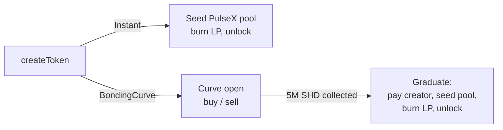

# SnipeHead Launch (`Shd-Launcher`)

Permissionless token launchpad for **PulseChain**, paired against **SHD (SnipeHead)**.
Anyone can create a fixed-supply token and launch it in one of two modes. Liquidity is always
locked forever (LP is burned) and the contracts have **no owner, no pause, no upgrade path and no rescue function**.

| | |
|---|---|
| **Network** | PulseChain mainnet (chain ID `369`) |
| **SHDLaunchFactory** | [`0x60eB086a1b15eDADd73351d6Da128F3fB64F6Cb0`](https://ipfs.scan.pulsechain.com/address/0x60eB086a1b15eDADd73351d6Da128F3fB64F6Cb0?tab=contract) |
| **Creation tx** | `0xcecf38b2be7ad4063858b691aa392270dccc2d04a1c4a6385cc1d02ab2c66564` |
| **Verification** | Sourcify (exact match) and PulseChain Blockscout |
| **Solidity** | `0.8.26`, EVM target `paris` |
| **Framework** | [Foundry](https://book.getfoundry.sh/) + [Solady](https://github.com/Vectorized/solady) |
| **License** | MIT |

> Part of the [SnipeHead](https://github.com/PBaieck-group/SnipeHead) monorepo, located in the [`Shd-Launcher`](https://github.com/PBaieck-group/SnipeHead/tree/main/Shd-Launcher) folder.

---

## Table of contents

1. [How it works](#how-it-works)
2. [Contracts](#contracts)
3. [Deployed addresses](#deployed-addresses)
4. [Project structure](#project-structure)
5. [Getting started](#getting-started)
6. [Testing](#testing)
7. [Deploying](#deploying)
8. [Verifying on the explorer](#verifying-on-the-explorer)
9. [Interacting with the factory](#interacting-with-the-factory)
10. [Security notes](#security-notes)
11. [Disclaimer](#disclaimer)

---

## How it works

Every token is a `LaunchToken`: **21,000,000 tokens, 18 decimals, fixed supply**, minted at creation to the
factory. The creator pays a **10 SHD creation fee**, which is sent straight to the SHD BuyAndBurn contract.
The creator always receives **5 %** of the supply (1,050,000 tokens); the other **95 %**
(19,950,000 tokens) goes to the market.

While a token is locked, it can only move to or from the factory. It becomes freely tradable only when the
factory calls `launch()` after seeding a PulseX V2 pool, so nobody can front-run a launch or create a rival pool first.

### Mode 1 – Instant

One transaction: `createToken(...)` creates, seeds and launches.

1. Creator pays `CREATION_FEE` (10 SHD) plus `shdAmount_` (any amount greater than 0).
2. Creator receives 5 % of the supply immediately.
3. `shdAmount_` SHD + the remaining 95 % of tokens are seeded into a fresh PulseX V2 pool.
4. LP tokens are sent to the burn address (`0x…0369`).
5. The token is unlocked and trades immediately.

### Mode 2 – Bonding curve

A constant-product curve over 95 % of the supply, open until **5,000,000 SHD** has been collected. There is no time limit.

- `buy` / `sell` against the curve at any time before graduation, so holders can always exit.
- When the target is reached, the factory **graduates** the token automatically in the same `buy` transaction
  (`graduate()` also exists as a permissionless safety net).
- On graduation:
  - the creator receives **50,000 SHD** (1 % of target) **and** their 5 % token allocation (held by the factory until now, so it can never be sold into the curve),
  - the remaining SHD (4.95 M) + all unsold tokens are seeded into a PulseX V2 pool,
  - LP is burned and the token is unlocked.
- Virtual reserves are chosen so the curve's marginal price at graduation equals the pool's opening price (no price cliff). Per the contract notes: about 15.17 M tokens sold and about 1.036 SHD/token at graduation.



### Key parameters

| Constant | Value |
|---|---|
| `TOKEN_SUPPLY` | 21,000,000 |
| `CREATOR_ALLOCATION` | 1,050,000 (5 %) |
| `CURVE_SUPPLY` | 19,950,000 (95 %) |
| `CREATION_FEE` | 10 SHD |
| `GRADUATION_TARGET` | 5,000,000 SHD |
| `CREATOR_REWARD` | 50,000 SHD |
| `GRADUATION_DUST` | `1e6` wei (prevents a 1-wei grief on the final buy) |
| `DEAD` (LP burn) | `0x0000000000000000000000000000000000000369` |

---

## Contracts

### `src/SHDLaunchFactory.sol`
The factory. Deploys tokens, runs both launch modes, hosts the bonding curve and seeds liquidity.

- Seeds liquidity by transferring directly to the pair and calling `pair.mint()` instead of using the router. The router's `addLiquidity()` can be blocked by donating dust to an empty pair and calling `sync()`; the direct route cannot.
- Verifies the SHD amount actually received on every pull, so a fee-on-transfer token cannot unbalance the curve accounting.
- Reentrancy guard on all state-changing entry points.
- Slippage and optional deadline on `buy` / `sell`; optional transaction expiry on `createToken` (this is **not** a launch limit).
- View helpers: `quoteBuy`, `quoteSell`, `getCurve`, `allTokensLength`, `allTokens`, `creatorOf`, `modeOf`.

### `src/SnipeLaunchToken.sol` (`LaunchToken`)
Fixed-supply ERC-20 on Solady, with EIP-2612 permit.

- Transfer lock until `launch()`, which only the factory can call. There is no time-based unlock.
- Immutable `creator`, `graffiti` and `initialRecipient`; no owner and no admin.
- `burn` and `burnFrom`.
- Validated, length-capped on-chain metadata (`description`, `website`, `image`) with `tokenURI()` / `contractURI()` returning a base64 JSON data URI. Websites must be `https://` or `ipfs://`; images may also be `data:image/`.
- Name: 1–32 printable ASCII characters. Symbol: 1–12 printable ASCII characters, no spaces.

### `src/SnipeHead.sol`
The SHD (SnipeHead) token source, used by the test suite and testnet deployment to mirror mainnet SHD (launched, ownership renounced, no transfer fee).

### `src/testnet/SHDLaunchFactoryTestnet.sol`
Identical logic to the mainnet factory, except `SHD`, `BUY_AND_BURN` and `FACTORY` are constructor-injected immutables instead of hardcoded PulseChain addresses. **Testnet only. Never deploy to mainnet.**

This file is **generated**, not hand-edited. After any change to `src/SHDLaunchFactory.sol`, regenerate it:

```bash
bash script/gen-testnet-factory.sh
```

The script rewrites the import path, the contract name and the three address constants, adds the constructor, and fails if any mainnet address is left in the output.

---

## Deployed addresses

### PulseChain mainnet (chain ID 369)

| Contract | Address |
|---|---|
| SHDLaunchFactory | `0x60eB086a1b15eDADd73351d6Da128F3fB64F6Cb0` |
| SHD | `0xB95bC84f9B6D0373642D586b81979B067572f7bc` |
| BuyAndBurn | `0x3677e61A7a9E79Fe45a882C201365C5165A5540e` |
| PulseX V2 factory | `0x29eA7545DEf87022BAdc76323F373EA1e707C523` |

### PulseChain testnet v4 (chain ID 943)

| Contract | Address |
|---|---|
| SHDLaunchFactory (testnet build) | `0x9dB37A5102e59f254e4DBB2493fA6aa5E1B8c51E` |
| SHD (test) | `0x60eB086a1b15eDADd73351d6Da128F3fB64F6Cb0` |
| V2 factory (mock) | `0xF5590631f05a3789dB59eBC0c46687B9Dd35d337` |
| BuyAndBurn sink | `0x163c077ef5eED651718dB5D50A1EF65F5D2FB462` |
| Example token | `0x51dFE21F47fD5576B1D6F576A3CDe1570776Cf7f` |

> The testnet *test SHD* token and the mainnet *factory* share the same address on different chains. Always check the chain ID.

The same list is kept in [`src/ADDRESSES.md`](src/ADDRESSES.md).

---

## Project structure

Generated with:

```bash
tree -I 'out|cache|broadcast|lib|node_modules|.git|.vscode|.idea|target|.DS_Store|*.bin|*.json'
```

```text
.
├── foundry.lock
├── foundry.toml
├── lcov.info
├── pair_src.txt
├── README.md
├── script
│   ├── DeployMainnet.s.sol
│   ├── DeployTestnet.s.sol
│   ├── gen-testnet-factory.sh
│   └── TestnetE2E.s.sol
├── src
│   ├── ADDRESSES.md
│   ├── SHDLaunchFactory.sol
│   ├── SnipeHead.sol
│   ├── SnipeLaunchToken.sol
│   └── testnet
│       └── SHDLaunchFactoryTestnet.sol
└── test
    ├── LaunchToken.invariant.t.sol
    ├── LaunchToken.t.sol
    ├── mocks
    │   └── MockPulseX.sol
    ├── SHDLaunchFactory.forkdiag.t.sol
    ├── SHDLaunchFactory.fork.t.sol
    ├── SHDLaunchFactory.hardening.t.sol
    ├── SHDLaunchFactory.invariant.t.sol
    ├── SHDLaunchFactory.testnet.t.sol
    └── SHDLaunchFactory.t.sol

6 directories, 23 files
```

| Path | Purpose |
|---|---|
| `foundry.toml` | Compiler (`0.8.26`, `paris`), optimizer (200 runs), remappings, RPC aliases, fuzz and invariant settings |
| `foundry.lock` | Pinned dependency revisions |
| `lcov.info` | Coverage report generated by `forge coverage` |
| `pair_src.txt` | Source of the PulseX V2 pair, kept for reference (the 2-argument `mint(to, senderOrigin)`) |
| `script/DeployMainnet.s.sol` | Production deployment with chain-ID and dependency checks |
| `script/DeployTestnet.s.sol` | Full-stack testnet deployment (test SHD, mock V2 factory, testnet factory) |
| `script/gen-testnet-factory.sh` | Regenerates `src/testnet/SHDLaunchFactoryTestnet.sol` from the production factory |
| `script/TestnetE2E.s.sol` | Live end-to-end run on testnet that creates demo tokens for the front-end |
| `src/ADDRESSES.md` | Deployed addresses (mainnet and testnet) and the mainnet creation tx |
| `test/mocks/MockPulseX.sol` | `MockSHD`, `MockPair`, `MockV2Factory` |

---

## Getting started

### Prerequisites

- [Foundry](https://book.getfoundry.sh/getting-started/installation) (`curl -L https://foundry.paradigm.xyz | bash && foundryup`)
- Git

### Install

```bash
git clone https://github.com/PBaieck-group/SnipeHead.git
cd SnipeHead/Shd-Launcher

# dependencies (libs/ is git-ignored)
forge install vectorized/solady foundry-rs/forge-std
forge build
```

### Compiler settings

From `foundry.toml`:

```toml
solc_version   = "0.8.26"
evm_version    = "paris"     # no PUSH0 / MCOPY: required for PulseChain
optimizer      = true
optimizer_runs = 200
remappings     = ["solady/=lib/solady/", "forge-std/=lib/forge-std/src/"]
```

> **Do not change `evm_version`.** Solidity 0.8.26 defaults to Cancun, which emits opcodes PulseChain may not support. The test suite includes an opcode scanner that fails if `PUSH0`, `MCOPY`, `TSTORE`/`TLOAD` or `BLOB*` opcodes appear in the deployed bytecode.

---

## Testing

### Offline (default)

```bash
forge test            # everything that needs no RPC
forge test -vvv       # with traces
```

Fork tests skip themselves unless enabled, so plain `forge test` works without any network access.

### Mainnet fork tests

Run against real PulseChain state (real SHD, real PulseX pairs):

```bash
RUN_FORK=1 forge test --match-path test/SHDLaunchFactory.fork.t.sol -vvv
RUN_FORK=1 forge test --match-contract HardeningForkTest -vvv
RUN_FORK=1 forge test --match-path test/SHDLaunchFactory.forkdiag.t.sol -vv   # diagnostic probe, prints instead of asserting
```

### Testnet fork tests

```bash
RUN_TESTNET=1 forge test --match-path test/SHDLaunchFactory.testnet.t.sol -vvv
```

### Coverage

```bash
forge coverage --report lcov
```

Latest `lcov.info` in this repo:

| File | Lines | Functions | Branches |
|---|---|---|---|
| `src/SHDLaunchFactory.sol` | 123 / 124 | 19 / 19 | 26 / 41 |
| `src/SnipeLaunchToken.sol` | 115 / 115 | 21 / 21 | 26 / 27 |

(`src/SnipeHead.sol` is a dependency of the testnet deployment and is not covered by the factory tests.)

### Test suites

| File | What it covers |
|---|---|
| `SHDLaunchFactory.t.sol` | Core factory behaviour for both modes: creation, fees, buy/sell, graduation, reverts, quotes. Runs offline using mocks etched at the hardcoded addresses |
| `SHDLaunchFactory.hardening.t.sol` | Opcode scan of deployed bytecode (Paris compatibility), burn-while-locked, tokens sent to the factory, pre-created pair attacks, multi-token invariants, SHD safety checks (no proxy, no privileged selectors, 18 decimals) and mainnet-fork scenarios (`msg.sender` ≠ `tx.origin`, large donations to a pre-created pair, LP fully burned) |
| `SHDLaunchFactory.invariant.t.sol` | Curve invariants: custody matches accounting, tokens sold equal holder balances, constant product never decreases, curve is solvent |
| `SHDLaunchFactory.fork.t.sol` | Instant launch, graduation, donate-and-sync resilience and SHD no-transfer-fee on real PulseChain state |
| `SHDLaunchFactory.forkdiag.t.sol` | Step-by-step probe of the live chain for debugging |
| `SHDLaunchFactory.testnet.t.sol` | The testnet factory against the deployed v4 testnet stack |
| `LaunchToken.t.sol` | Token unit and fuzz tests: lock, launch, burn, permit, metadata validation, URI encoding |
| `LaunchToken.invariant.t.sol` | Balances sum to supply, supply equals initial minus burned, lock cannot be bypassed, launch is one-way |

Invariant and fuzz settings (`foundry.toml`): 1,000 fuzz runs; 256 invariant runs at depth 64, `fail_on_revert = false`.

---

## Deploying

### Mainnet

`DeployMainnet` refuses to run unless the chain ID is `369` and SHD, BuyAndBurn and the PulseX factory all have code at the expected addresses. After deployment it re-checks the factory's wiring.

```bash
export PRIVATE_KEY=0x...        # deployer key

# dry run
forge script script/DeployMainnet.s.sol:DeployMainnet --rpc-url pulsechain -vvv

# broadcast
forge script script/DeployMainnet.s.sol:DeployMainnet --rpc-url pulsechain --broadcast --slow -vvv
```

> Prefer a hardware wallet or an encrypted keystore (`--account <name>`) over a raw private key in your shell history.

### Testnet (chain ID 943)

Deploys a test SHD (the real `SnipeHead` source, launched and ownership renounced), a mock PulseX V2 factory and the testnet factory.

```bash
export PRIVATE_KEY=0x...        # TESTNET-ONLY key

forge script script/DeployTestnet.s.sol:DeployTestnet --rpc-url pulsechain_testnet -vvv
forge script script/DeployTestnet.s.sol:DeployTestnet --rpc-url pulsechain_testnet --broadcast --slow -vvv
```

Optional environment variables: `SHD_ADDRESS`, `V2_FACTORY`, `BUY_AND_BURN`, `SHD_SUPPLY` (wei, default 1e9 SHD).
The script prints `FACTORY_ADDRESS` and `SHD_ADDRESS` exports for the E2E script and the front-end.

### Testnet demo data (E2E)

`TestnetE2E` runs real transactions on testnet to give the front-end something to show. It funds three deterministic test wallets (alice, bob, whale), then creates:

| Token | State |
|---|---|
| Demo Instant (`DINST`) | Instant mode, created and launched in one transaction with 100k SHD |
| Demo Curve (`DCURVE`) | Bonding curve, partially bought, then half of one holder's tokens sold back (still open) |
| Demo Graduated (`DGRAD`) | Bonding curve bought to the 5M SHD target (graduated, pool seeded) |

```bash
export PRIVATE_KEY=0x...        # TESTNET-ONLY key
export FACTORY_ADDRESS=0x...    # from DeployTestnet output
export SHD_ADDRESS=0x...        # from DeployTestnet output

# dry run
forge script script/TestnetE2E.s.sol:TestnetE2E --rpc-url pulsechain_testnet -vvv

# live
forge script script/TestnetE2E.s.sol:TestnetE2E --rpc-url pulsechain_testnet \
  --broadcast --slow --legacy --with-gas-price 10000000000 -vvv
```

> The alice, bob and whale keys are derived from fixed strings, so they are **publicly known**. Use them on testnet only.

---

## Verifying on the explorer

The mainnet factory takes no constructor arguments.

```bash
# Sourcify
forge verify-contract 0x60eB086a1b15eDADd73351d6Da128F3fB64F6Cb0 \
  src/SHDLaunchFactory.sol:SHDLaunchFactory \
  --chain 369 --verifier sourcify

# PulseChain Blockscout
forge verify-contract 0x60eB086a1b15eDADd73351d6Da128F3fB64F6Cb0 \
  src/SHDLaunchFactory.sol:SHDLaunchFactory \
  --chain 369 --verifier blockscout \
  --verifier-url https://api.scan.pulsechain.com/api/
```

Tokens created by the factory are plain `LaunchToken` instances and share the same source.

---

## Interacting with the factory

All amounts are in wei (18 decimals). `Mode`: `0` = Instant, `1` = BondingCurve.

### Create a bonding-curve token

```bash
export FACTORY=0x60eB086a1b15eDADd73351d6Da128F3fB64F6Cb0
export SHD=0xB95bC84f9B6D0373642D586b81979B067572f7bc

# approve the 10 SHD creation fee
cast send $SHD "approve(address,uint256)" $FACTORY 10ether \
  --rpc-url pulsechain --account <keystore-name>

cast send $FACTORY \
  "createToken(string,string,bytes32,(string,string,string),uint8,uint256,uint256)" \
  "My Token" "MTK" 0x0000000000000000000000000000000000000000000000000000000000000000 \
  '("A short description","https://example.com","ipfs://<cid>")' \
  1 0 0 \
  --rpc-url pulsechain --account <keystore-name>
```

### Create an Instant token

Approve `10 SHD + shdAmount_`, then call `createToken` with mode `0` and `shdAmount_ > 0`.

### Buy, sell, graduate

```bash
cast call $FACTORY "quoteBuy(address,uint256)(uint256)" <token> 1000ether --rpc-url pulsechain
cast call $FACTORY "getCurve(address)(uint256,uint256,bool,address)" <token> --rpc-url pulsechain

# buy(token, shdIn, minTokensOut, deadline)   (approve SHD first)
cast send $FACTORY "buy(address,uint256,uint256,uint256)" <token> 1000ether <minOut> 0 \
  --rpc-url pulsechain --account <keystore-name>

# sell(token, tokensIn, minShdOut, deadline)  (approve the token first)
cast send $FACTORY "sell(address,uint256,uint256,uint256)" <token> <amount> <minOut> 0 \
  --rpc-url pulsechain --account <keystore-name>

# permissionless fallback if the target is reached but graduation did not run
cast send $FACTORY "graduate(address)" <token> --rpc-url pulsechain --account <keystore-name>
```

Use `minTokensOut` / `minShdOut` for slippage protection. A `deadline` of `0` means none.

---

## Security notes

- **Immutable and ownerless.** No admin keys, no pause, no upgrade, no rescue. Bugs cannot be patched after deployment.
- **LP is burned**, not locked: liquidity cannot be removed.
- **Transfer lock** prevents pre-launch trading and rival pool creation; the factory is the only address that can move locked tokens.
- **Pair seeding** goes directly through `pair.mint()`, which defeats the empty-pair donation/`sync()` griefing that breaks router-based `addLiquidity()`. Donated SHD is simply absorbed into the burned LP.
- **Rounding** on the curve always favours the curve.
- **Dust handling** at the graduation target avoids a state where the last 1 wei cannot be bought.
- **Paris-only bytecode** is enforced by tests.
- **Audit status:** `SnipeLaunchToken.sol` has been audited. `SHDLaunchFactory.sol` has been reviewed, hardened and covered by unit, fuzz, invariant and fork tests.

Found a vulnerability? Please open a private security advisory on the GitHub repository rather than a public issue.

---

## Disclaimer

This software is provided "as is", without warranty of any kind. Launching and trading tokens carries
substantial financial risk, and smart contracts on a public chain cannot be changed once deployed. Tokens created through
this factory are created by third parties; their appearance here is not an endorsement. Nothing in this repository is financial advice.

## License

MIT
